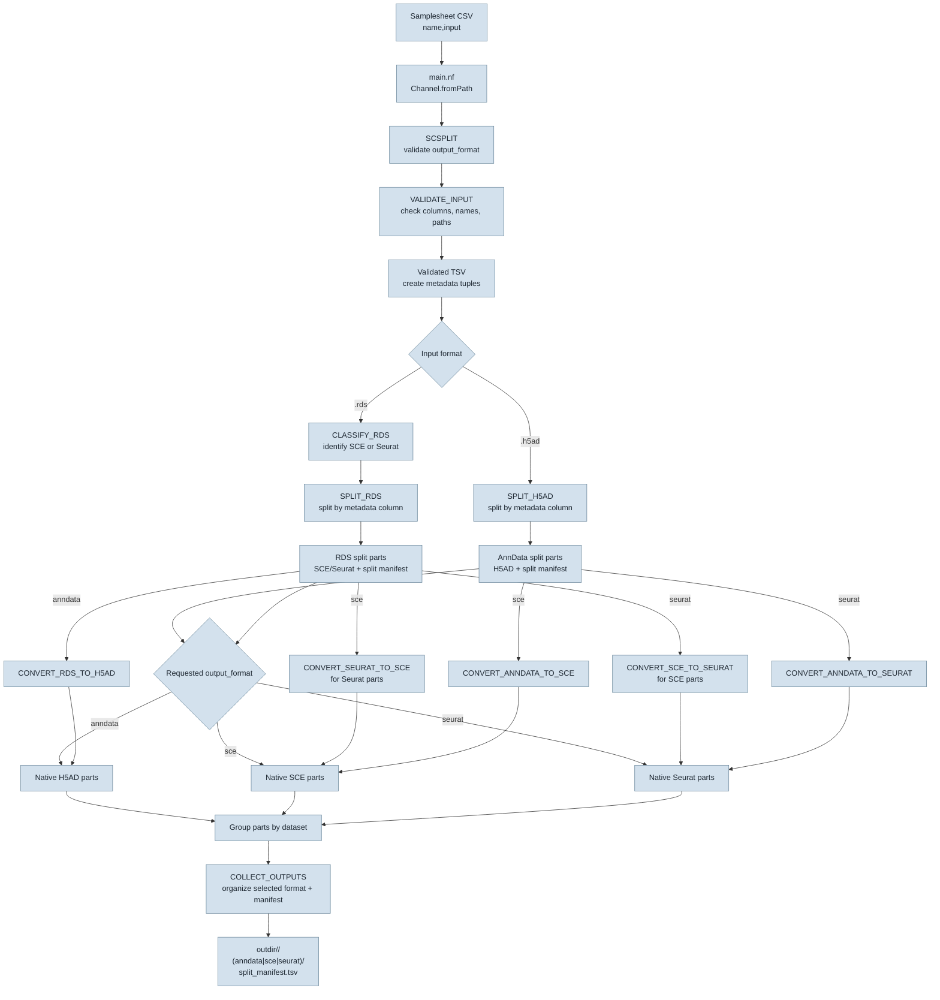

# scsplit

Nextflow workflow that splits H5AD/AnnData, SingleCellExperiment RDS, or Seurat RDS inputs by one cell metadata column and emits one selected output object format.

## Workflow



The workflow keeps native parts when they already match `--output_format` and invokes only the required conversion processes for other input types. Each dataset is grouped before `COLLECT_OUTPUTS`, which publishes the selected format and its manifest under `--outdir`.

## Inputs

`--input` is a CSV samplesheet with exactly these columns:

```csv
name,input
pbmc_01,/data/pbmc_01.h5ad
pbmc_02,/data/pbmc_02.rds
```

Dataset names must be unique and contain only letters, digits, `_`, `-`, and `.`. Inputs must end in `.h5ad` or `.rds`; RDS objects are checked at runtime and must be SingleCellExperiment or Seurat.

## Execution Environments

Build the shared runtime image from the repository root:

```bash
docker build -f containers/Dockerfile -t scsplit:0.1.0 .
apptainer build containers/scsplit.sif containers/scsplit.def
```

The Dockerfile and Singularity/Apptainer definition use the shared dependency list in `containers/environment.yml`. The unified image includes Python 3.11, R 4.5, AnnData, SingleCellExperiment, Seurat, anndataR, anndata2ri, rpy2, and the libraries needed by all local modules. Module-specific `environment.yml` files remain the source for the Conda profile.

Choose one profile per run:

```bash
# Conda creates module environments from their environment.yml files.
nextflow run . -profile conda --input samplesheet.csv --split_column donor

# Docker uses the local image built above. Override the default if needed.
nextflow run . -profile docker --container_image scsplit:0.1.0 --input samplesheet.csv --split_column donor

# Singularity and Apptainer use containers/scsplit.sif; build it before running.
nextflow run . -profile singularity --input samplesheet.csv --split_column donor
nextflow run . -profile apptainer --input samplesheet.csv --split_column donor
…
```

Install the selected runtime on the execution host; Nextflow does not install Docker, Singularity, or Apptainer. For clusters, configure the executor and a suitable shared container cache separately.

Run the bundled simulated H5AD and SingleCellExperiment inputs with:

```bash
nextflow run . -profile singularity \
    --input tests/test_data/samplesheet_all.csv \
    --split_column donor \
    --output_format anndata \
    --outdir results/test_data
```

The selected `output_format` is exactly one of `anndata` (AnnData H5AD), `sce` (SingleCellExperiment RDS), or `seurat` (Seurat RDS). Each run produces only the selected target format.

`--input` is converted to a checked file channel before it reaches the workflow's `path` input. The Singularity/Apptainer profiles use `containers/scsplit.sif`, which must be built on a Linux host with the selected runtime installed.
## Run

```bash
nextflow run . -profile docker --input samplesheet.csv --split_column donor --output_format anndata --outdir results
```

`--output_format` accepts `anndata` (default), `sce`, or `seurat`. The workflow automatically detects RDS object type, performs native splitting where possible, and converts only when the requested target differs from the input. Missing split columns, missing group values, unsupported RDS classes, and empty cell/feature dimensions fail the task.

Each dataset is published to `<outdir>/<name>/` (for example, `results/test_data/simulated_h5ad/`). Files are placed in `anndata/`, `sce/`, or `seurat/` according to the selected output format. `split_manifest.tsv` records source object type, final object type, original split value, final format/path, cell count, and feature count. Unsafe group values are sanitized for filenames; manifest values remain unchanged and sanitized-name collisions receive a stable digest suffix.

Nextflow task logs and intermediate files remain under `work/`; final dataset directories are copied to `<outdir>`.
