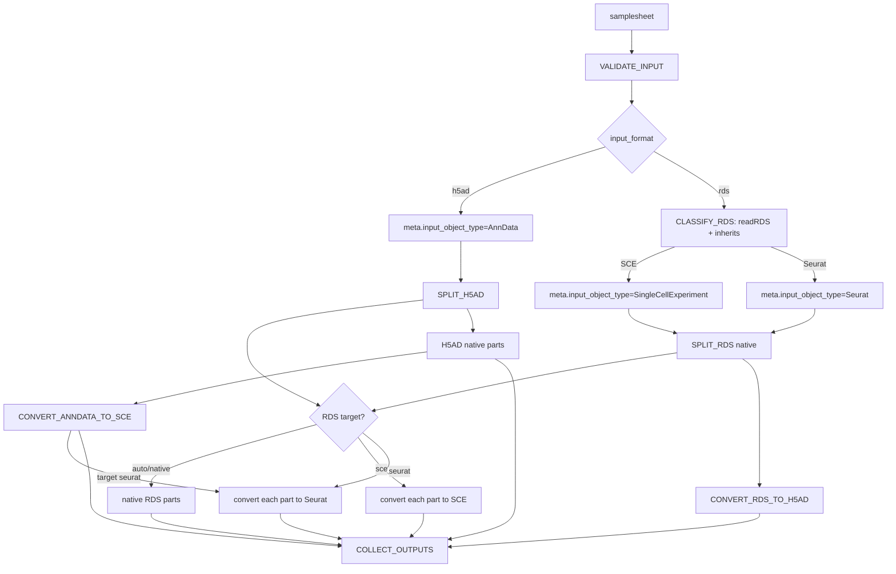

# Seurat 兼容实现计划

> **For Claude:** REQUIRED SUB-SKILL: Use superpowers:executing-plans to implement this plan task-by-task.

**Goal:** 让流程自动识别 `.rds` 输入是 SingleCellExperiment 还是 Seurat，并通过统一的 `--output_format` 参数选择输出对象类型。

**Architecture:** 保留 `.rds` 作为输入格式；新增 R 运行时分类步骤，将 `input_object_type` 写入 metadata。输入对象先在原生类型中按细胞元数据拆分，再按 `output_format=anndata|sce|seurat` 转换为目标类型。`anndata` 输出 `.h5ad`，`sce` 和 `seurat` 输出 `.rds`；一次运行只生成一种目标格式。

**Tech Stack:** Nextflow DSL2、R 4.5、Seurat/SeuratObject、SingleCellExperiment、Python 3.11、AnnData、rpy2/anndata2ri、现有 Conda/Docker/Singularity 环境。

---

## 1. 已确定的输入与输出契约

### 自动输入识别

- samplesheet 仍只需要 `name,input` 两列；`.h5ad` 自动标记为 `input_object_type=AnnData`。
- `.rds` 不能仅按扩展名判断对象类型。新增 `CLASSIFY_RDS` R 进程，使用 `readRDS()` 和 `inherits()` 自动识别：
  - `SingleCellExperiment` → `input_object_type=SingleCellExperiment`；
  - `Seurat`/验证过的 SeuratObject 类 → `input_object_type=Seurat`；
  - 其他类型立即失败。
- 分类结果进入 Nextflow metadata，后续 split 和 conversion 过程都使用该类型；拆分过程仍再次校验实际对象类型，防止 metadata 与文件内容不一致。

### 统一输出参数

只保留一个输出参数：

```text
--output_format anndata|sce|seurat
```

默认值为 `anndata`，一次运行只生成一种目标格式：

- `anndata`：输出 H5AD，内部对象始终为 AnnData。
- `sce`：输出 SingleCellExperiment RDS。
- `seurat`：输出 Seurat RDS。

不再使用 `output_object_type` 参数，也不再支持旧的 `output_format=h5ad|rds|both` 枚举。目标对象类型和物理文件格式由同一个 `output_format` 参数决定。

### 支持矩阵

| 输入 | `output_format=anndata` | `output_format=sce` | `output_format=seurat` |
|---|---|---|---|
| H5AD / AnnData | AnnData H5AD | SingleCellExperiment RDS | Seurat RDS |
| SCE RDS | AnnData H5AD | SingleCellExperiment RDS | Seurat RDS |
| Seurat RDS | AnnData H5AD | SingleCellExperiment RDS | Seurat RDS |

### 对象转换边界

- RDS 输入先按原生对象拆分，避免 Seurat 先转 SCE 后丢失 Seurat 专有结构。
- `output_format=sce`：SCE 输入可原生保存；Seurat 输入执行 Seurat→SCE；H5AD 输入执行 H5AD→SCE。
- `output_format=seurat`：Seurat 输入可原生保存；SCE 输入执行 SCE→Seurat；H5AD 输入执行 H5AD→Seurat。
- `output_format=anndata`：H5AD 输入可原生保存；SCE/Seurat 输入执行 RDS→H5AD。
- Seurat→H5AD、Seurat→SCE 和 H5AD→Seurat 只承诺可验证的主表达矩阵、cell metadata、feature metadata 和可映射 reductions；缺少可用 counts 层必须失败。
- 不再提供 `both`；如需多种输出，用户需要运行两次流程，分别指定目标 `output_format`。

## 2. 目标数据流



`CLASSIFY_RDS` 是输入自动判断的唯一入口；`SPLIT_RDS` 仍对实际对象做二次校验。`output_format` 决定最终对象类型和文件格式。

## 3. 实施任务

### Task 1: 增加 RDS 自动对象识别

**Files:**
- Create: `modules/local/classify_rds/main.nf`
- Create: `modules/local/classify_rds/environment.yml`
- Create: `modules/local/classify_rds/templates/classify_rds.R`

**Implementation:**

1. `CLASSIFY_RDS` 接收 `tuple val(meta), path(input), val(split_column)`，读取 RDS 并使用 `inherits()` 判断对象类型。
2. 输出相同 input 文件和更新后的 `meta.input_object_type`：`SingleCellExperiment` 或 `Seurat`；其他对象立即失败。
3. 该过程只做类型识别，不做拆分和转换，避免一个模块同时承担对象判断、分组和格式转换。
4. `meta` 中保留 `input_format='rds'`、`name`、`id`，确保现有 collector 和 workflow 元数据不变。
5. 在 `versions.yml` 记录 R、SingleCellExperiment/SeuratObject 版本。

**Acceptance:** SCE RDS 和 Seurat RDS 分别被自动标记；普通 RDS 在 split 前失败。

### Task 2: 替换 RDS 拆分模块为对象类型无关实现

**Files:**
- Create: `modules/local/split_rds/main.nf`
- Create: `modules/local/split_rds/templates/split_rds.R`

**Implementation:**

1. 输入契约为 `tuple val(meta), path(input), val(split_column)`；`meta.input_object_type` 来自 `CLASSIFY_RDS`。
2. 脚本再次读取并校验实际对象类，防止分类结果与输入文件不一致。
3. SCE 使用 `colData(sce)[[split_column]]` 和列子集；Seurat 使用细胞 metadata 和 Seurat 原生 cell subset API。两个分支都先在原生对象中拆分。
4. 统一检查对象有 cells/features、split column 存在、无缺失值且至少有一个 group。
5. split 模块只生成原生类型的临时 RDS parts；最终目标类型由 workflow 根据 `output_format` 选择 converter，不在 split 模块内隐式转换。
6. 复用当前安全文件名和 SHA-256 冲突后缀规则；manifest 保存原始 `split_value`。
7. manifest 增加 `input_object_type`、实际 `output_object_type` 和 `output_format`；native RDS part 的 `output_object_type` 与输入类型相同。

**Acceptance:** 同一个 split 模块可产生 SCE 和 Seurat native parts；不会因目标输出类型改变而丢失原生对象结构。

### Task 3: 接入自动识别、目标输出类型和 workflow

**Files:**
- Modify: `workflows/scsplit.nf`
- Modify: `main.nf`
- Modify: `nextflow.config`
- Modify: `nextflow_schema.json`

**Implementation:**

1. 新增 `params.output_format = 'anndata'`，schema 枚举为 `anndata`、`sce`、`seurat`。
2. `VALIDATE_INPUT` 后将 H5AD metadata 标记为 `input_object_type='AnnData'`；RDS rows 进入 `CLASSIFY_RDS`，再进入 `SPLIT_RDS`。
3. workflow 将 `output_format` 传入输出选择逻辑：`anndata` 选择 H5AD/native 或 RDS→H5AD；`sce` 选择 SCE native/converter 或 H5AD→SCE；`seurat` 选择 Seurat native/converter 或 H5AD→Seurat。
4. 不再支持 `h5ad`、`rds`、`both` 枚举，也不再传递 `output_object_type`。
5. RDS 输入先原生拆分，再按目标 `output_format` 执行必要的 Seurat↔SCE 转换；H5AD 输入按目标格式执行 H5AD→SCE 或 H5AD→Seurat。
6. 输出目录根据最终格式使用 `anndata/`、`sce/` 或 `seurat/`，manifest 记录实际对象类型。

**Acceptance:** 参数可选择 `anndata`、`sce` 或 `seurat` 三种唯一目标格式；每次运行只发布对应格式。

### Task 4: 实现 RDS 对象类型转换模块

**Files:**
- Create: `modules/local/convert_sce_to_seurat/main.nf`
- Create: `modules/local/convert_sce_to_seurat/environment.yml`
- Create: `modules/local/convert_sce_to_seurat/templates/convert_sce_to_seurat.R`
- Create: `modules/local/convert_seurat_to_sce/main.nf`
- Create: `modules/local/convert_seurat_to_sce/environment.yml`
- Create: `modules/local/convert_seurat_to_sce/templates/convert_seurat_to_sce.R`

**Implementation:**

1. 每个 converter 接收一个 split RDS 和其 manifest，输出同名目标 RDS 及更新后的 manifest。
2. SCE→Seurat：以主 assay/counts、`colData`、`rowData` 构造 Seurat，并尽可能迁移可验证的 reducedDims；没有可构造的表达矩阵时失败。
3. Seurat→SCE：以默认 assay 的 counts、细胞 metadata、feature metadata 和可映射 reductions 构造 SCE；没有 counts 时失败。
4. converter 必须验证输出对象类、cell/feature 数和 cell names；不允许通过保存原对象伪造目标类型。
5. 依赖显式加入 Seurat/SeuratObject、SingleCellExperiment、Matrix 等实际所需包，并验证 Conda 与 unified container 可解析。
6. 依赖显式加入 Seurat/SeuratObject、SingleCellExperiment、Matrix 等实际所需包，并验证 Conda 与 unified container 可解析。

**Acceptance:** SCE↔Seurat 转换后的 RDS 可以读回为目标类，并保持拆分后的 cell 集合。

### Task 5: 扩展 RDS → H5AD 转换

**Files:**
- Modify: `modules/local/convert_rds_to_h5ad/templates/convert_rds_to_h5ad.py`
- Modify: `modules/local/convert_rds_to_h5ad/environment.yml`
- Modify if needed: `containers/environment.yml`

**Implementation:**

1. 保留 SCE 路径，增加 Seurat runtime class detection；不能仅通过 manifest 猜测。
2. Seurat 分支提取默认 assay counts、cell/feature names、`obj[[]]` metadata、可转换 reductions 和 variable features。
3. 校验矩阵维度、名称和 metadata 对齐；多 layer 使用已验证 API；没有可用 counts 明确失败。
4. 输出 manifest 将 `output_object_type` 设为 `AnnData`，保留真实 `input_object_type`。

**Acceptance:** Seurat split RDS 可生成可读取 H5AD；SCE→H5AD 回归通过。

### Task 6: 更新 manifest 收集与格式匹配

**Files:**
- Modify: `modules/local/collect_outputs/templates/collect_outputs.py`

**Implementation:**

1. 将 `input_object_type`、实际 `output_object_type` 和请求的 `output_format` 纳入固定字段顺序。
2. 将当前 `records_by_stem` 单键索引改为至少 `(output basename, output_format)`；同一运行只产生一个目标格式，但复合键避免未来记录覆盖。
3. collector 选择记录时必须同时匹配输出文件名和最终格式；找不到记录仍然失败。
4. 最终 `split_manifest.tsv` 保留输入对象类型、最终对象类型和 `output_format`；文件路径使用 `anndata/<file>`、`sce/<file>` 或 `seurat/<file>`。
5. 确认混合输入数据集仍按同一数据集目录汇总，且不同来源对象的 manifest 记录不会混淆。

**Acceptance:** 每次运行只产生一种目标格式；`output_format=seurat` 的 RDS 行明确标记 `output_object_type=Seurat`。

### Task 7: 增加 Seurat fixture 与可重复验证入口

**Files:**
- Create: `tests/test_data/generate_test_data_seurat.R`
- Create: `tests/test_data/simulated_seurat.rds`
- Create: `tests/test_data/samplesheet_seurat.csv`
- Modify: `tests/test_data/README.md`

**Fixture requirements:**

- 至少 12 cells、6 features；包含 `donor`、`batch` 等 metadata；复用现有特殊值场景：`donor A`、`donor_A`、`donor/B`。
- 至少一个默认 assay counts 矩阵；如测试 reductions，则生成一个小型可验证 reduction。
- 生成脚本固定 metadata seed/值，不依赖随机结果；说明所需 Seurat 版本。

**Validation matrix:**

| 场景 | 可观察断言 |
|---|---|
| Seurat + `sce` | 每组 RDS 可读回且为 SingleCellExperiment |
| Seurat + `seurat` | 每组 RDS 可读回且为 Seurat |
| SCE + `seurat` | 每组 RDS 可读回且为 Seurat |
| H5AD + `sce` | 每组 RDS 可读回且为 SingleCellExperiment |
| H5AD + `seurat` | 每组 RDS 可读回且为 Seurat |
| Seurat + `anndata` | 每组 H5AD 可由 AnnData 读取，obs、矩阵形状和 donor 集合正确 |
| 无效 RDS | 普通 `saveRDS(list(...))` 在分类阶段失败，错误明确列出支持类型 |
| 缺少 counts | Seurat → H5AD、Seurat→SCE 或 H5AD→Seurat 明确失败，不输出伪造矩阵 |
| 每次单一输出 | `anndata`、`sce`、`seurat` 三种参数分别只产生对应目录和文件类型 |

由于仓库当前没有 nf-test 配置、测试快照或测试数据集，第一轮实现使用实际 Nextflow smoke runs 加上 R/Python 结果检查；不要宣称未运行的 nf-test 覆盖率。

### Task 8: 更新设计、README 和参数说明

**Files:**
- Modify: `README.md`
- Modify: `DESIGN.md`
- Modify: `nextflow_schema.json`
- Modify: `nextflow.config`/`main.nf`
- Modify: `containers/environment.yml` only when dependency versions are finalized

**Documentation requirements:**

1. 明确 `.rds` 可以是 SingleCellExperiment 或 Seurat；流程自动识别，不要求 samplesheet 增加对象类型列。
2. 明确唯一输出参数 `--output_format anndata|sce|seurat`，默认值为 `anndata`。
3. 明确 `anndata` 输出 H5AD，`sce` 输出 SingleCellExperiment RDS，`seurat` 输出 Seurat RDS；每次运行只输出一种格式。
4. 明确 H5AD → Seurat、SCE ↔ Seurat 转换的可保留内容和失败边界。
5. 更新目录结构和 manifest 字段示例，加入 `input_object_type`、实际 `output_object_type` 和 `output_format`。
6. 移除旧的 `h5ad|rds|both` 参数说明以及“RDS 仅支持 SingleCellExperiment”和“Seurat 是非目标”的过时表述；同步更新 live workflow 与设计文档。


## 4. 验证命令与顺序

实现阶段按以下顺序执行，避免只验证脚本而漏掉 Nextflow channel 契约：

1. 用 Rscript 生成 Seurat fixture，并确认 `readRDS()`、`inherits(..., 'Seurat')`、默认 assay counts 和 split metadata 存在。
2. 分别运行 `--output_format anndata|sce|seurat` 的完整 workflow，检查每次只生成对应目录和文件类型。
3. 单独运行 `SPLIT_RDS` 模板 smoke check：验证 Seurat/SCE 两个分支、碰撞命名、manifest 对象类型。
4. 单独运行 RDS → H5AD、SCE↔Seurat 和 H5AD→Seurat converter：验证 shape、metadata、对象类和 cell names。
5. 运行完整 workflow：
   ```bash
   nextflow run . -profile conda \
     --input tests/test_data/samplesheet_seurat.csv \
     --split_column donor \
     --output_format seurat \
     --outdir results/test_seurat
   ```
6. 对最终目录执行结果检查：每组文件数、文件可读性、cell/feature 数、manifest 行数、对象类型列、特殊值与稳定 hash 后缀。
7. 重跑已有 H5AD/SCE smoke command，确认默认 `output_format=anndata` 的行为。
8. 使用一个不支持的 RDS 和一个无 counts 的 Seurat fixture，确认分类/转换失败且没有被 collector 发布为成功结果。

## 5. 风险与缓解

| 风险 | 影响 | 缓解 |
|---|---|---|
| Seurat v4/v5 的 slot/layer API 差异 | 转换读错矩阵或失败 | 锁定已测试版本；优先使用 layer-aware API；异常时显式失败；fixture 覆盖实际版本 |
| Seurat 多 assay / 多 layer | H5AD 无法无损表达 | native RDS 保留全部结构；H5AD 只承诺默认 assay 的可验证投影，并记录最终对象类型 |
| Seurat 依赖体积和 Conda solver 冲突 | Conda 或容器构建失败 | 先在模块环境和 unified environment 分别做 resolver/build smoke；不要在未验证时写死版本号 |
| manifest 仅按 stem 匹配 | 同一目标格式下的记录错配 | 使用 basename + output format 复合键，并增加端到端断言 |
| Seurat 子集操作丢失结构 | native 输出不再是可用 Seurat | 使用 Seurat 原生 cell subset；对 assays、metadata、reductions 做读回检查 |
| 默认 assay 没有 counts | H5AD 表达矩阵语义不明确 | 明确失败；不自动用 data/scale.data 代替 counts |
| 现有文档描述过时 | 用户误用输入或误解输出 | 同一提交更新 README、DESIGN、fixture README 和 manifest 示例 |

## 6. 完成标准

- 现有 H5AD 与 SCE 路径的用户命令需按新的 `--output_format` 契约更新，并完成 smoke run。
- Seurat RDS 可按 `split_column` 原生拆分，并在 `output_format=seurat` 时读回仍为 Seurat。
- `output_format=seurat`、`sce`、`anndata` 分别只发布对应对象类型和文件格式。
- manifest 同时记录原始对象类型、最终对象类型和请求的输出格式。
- 不支持的 RDS、缺少 split column、缺失分组值、空对象和无可用 counts 的 Seurat 转换均明确失败。
- README、DESIGN 和依赖环境说明与 live workflow 一致。
